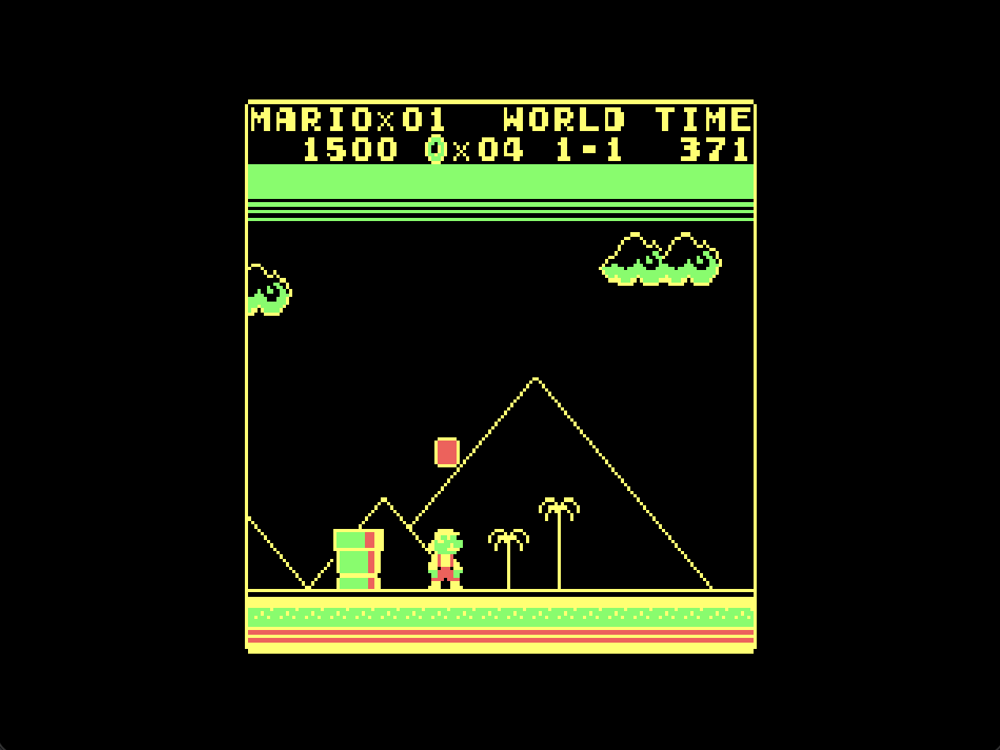
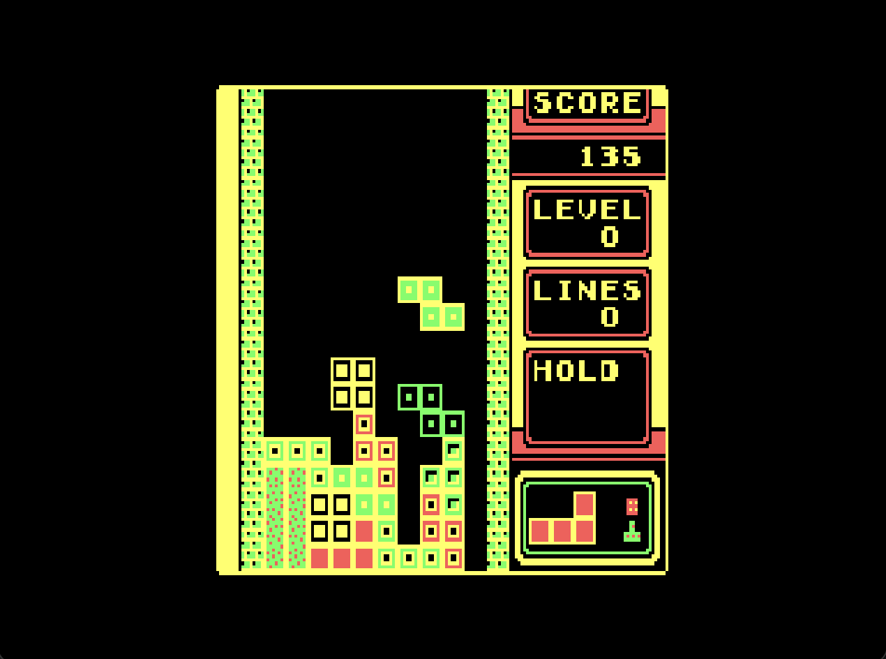
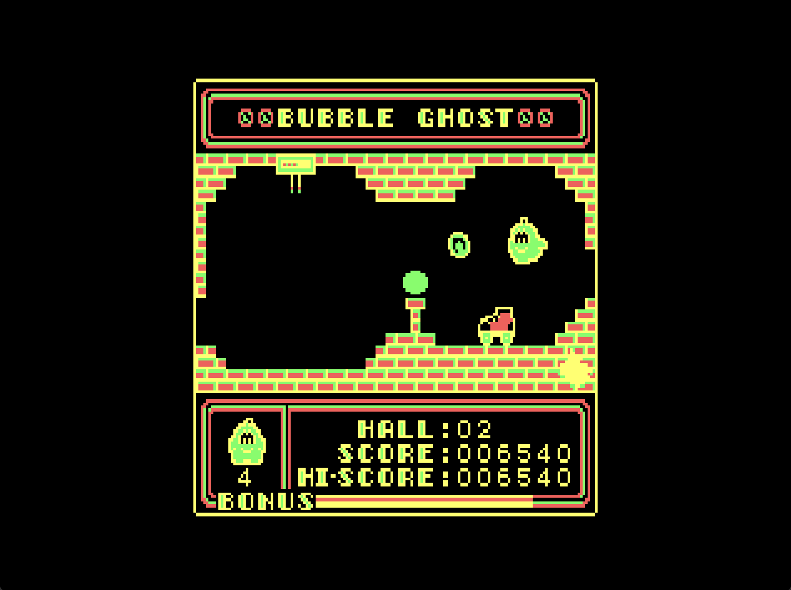

# GB200LX: Static Game Boy AOT Recompiler for HP 200LX (80186 MS-DOS)

[](LICENSE)
[](#hp-200lx-hardware-overview)
[](#hp-200lx-hardware-overview)

**GB200LX** is a "Bring Your Own ROM" ahead-of-time (AOT) static binary recompiler that translates original Game Boy (DMG / Sharp SM83) ROMs into native 16-bit x86 assembly (`bits 16`, `cpu 186`), producing standalone, self-contained MS-DOS `.EXE` binaries targeting the **HP 200LX palmtop PC** (7.91 MHz Intel Hornet 80186, 636 KiB conventional RAM, 320×200 4-shade grayscale CGA display).

---

## Screenshots (DOSBox-X `80186` + `cga` Emulation)

| *Super Mario Land* (World 1-1) | *Tetris* (Rosy Retrospection) | *Bubble Ghost* (Hall 02) |
| :---: | :---: | :---: |
|  |  |  |

> [!NOTE]
> Under desktop DOSBox-X in CGA Mode 04h (Palette 0), the 2-bit pixel values (`00b..11b`) display as black/green/red/yellow. On the HP 200LX LCD hardware, those exact 2-bit pixel values map directly to four physical shades of gray.

---

## Current Status & Compatibility

- **Supported ROMs:** Unmodified 32 KiB (ROM-only) and 64 KiB (MBC1, up to 4 × 16 KiB banks) DMG `.gb` ROMs statically mapped into 16-bit code segments.
- **Verified Playable Titles:**
  - *Super Mario Land (World) (Rev 1)* — full gameplay including `STAT`/`LYC` split-scroll HUD, 1-pixel `SCX` scrolling, sprites, pipes (OAM BG priority), and BCD timer.
  - *Tetris - Rosy Retrospection (v1.2)* — Window/BG rendering and gameplay.
  - *Bubble Ghost (USA, Europe)* — sprites, Window HUD, and full-speed gameplay.
- **Current Limitations:**
  - ROMs larger than 64 KiB (e.g., 1 MiB MBC3 titles) are not yet supported (would require disk-paged bank overlays and SRAM persistence).
  - Audio maps Game Boy Channels 1, 2 (square + sweep/envelope/length) and Channel 3 (wave fallback) to the single-voice HP 200LX PC speaker (Channel 4 noise is omitted).

---

## Why Static Recompilation?

Interpreting a 4.19 MHz Sharp SM83 CPU instruction-by-instruction on a 7.91 MHz 80186 leaves far too few cycles per Game Boy opcode for playable frame rates.

**GB200LX translates ROM code ahead of time:**
- **Zero Fetch/Decode Loop:** Each reachable SM83 instruction is lowered ahead of time into native 16-bit 80186 assembly with straight-line flag-liveness analysis to drop dead flag-save (`lahf`/`sahf`) sequences.
- **Physical Register Pinning:** SM83 registers (`A`, `BC`, `DE`, `HL`, `SP`) stay pinned in 80186 hardware registers across instructions and basic blocks.
- **Strip-Based CGA Tile-Cache Renderer:** Decodes dirty 8×8 VRAM tiles on demand into `cga_tile_cache`, composites BG (with 1-pixel `SCX & 7` fine scroll and `STAT` `LYC` HUD split), Window, and OAM sprites into an offscreen 8 KiB `backbuffer_seg`, and blits to `0xB800`.
  - At `cycles=fixed 7910` (7.91 MHz 80186 equivalent) in DOSBox-X: *Bubble Ghost* draws in **~13.2 ms/frame** (full 60 fps, zero frameskip) and *Super Mario Land* draws in **~16.5 ms/frame**.
- **59.73 Hz Hardware Pacing & Responsive Input:** Reprograms PIT channel 0 to 59.73 Hz (`INT 08h`, chaining the BIOS clock at 18.2 Hz) with adaptive frameskip (up to 3 skipped renders, ≥15 fps floor) and `HLT` idle sleep, plus `INT 09h` scancode hooking with per-frame joypad press latching.
- **PC Speaker Sound Synthesis:** Synthesizes Game Boy APU Channels 1 & 2 (with length counters, envelopes, and Ch1 frequency sweep) plus Channel 3 wave fallback via PIT channel 2 (`0x42`/`0x61`).
- **Relocation-Free Segmentation:** Multi-bank ROMs (up to 64 KiB / 4 banks) are split into contiguous 16-bit code segments with precomputed far-call dispatchers, requiring no EMS or protected-mode extenders.

---

## HP 200LX Hardware Overview

| Specification | HP 200LX Palmtop | GB200LX Adaptation |
| :--- | :--- | :--- |
| **CPU** | Intel Hornet 80186 ASIC @ 7.91 MHz | Native 16-bit 80186 instructions only (`bits 16`, `cpu 186`) |
| **RAM** | 636 KiB Conventional MS-DOS RAM | ~240–310 KiB footprint (EXE + 64 KiB GB RAM + 8 KiB backbuffer + stack) |
| **Display** | 320×200 4-shade grayscale LCD (CGA Mode 04h) | Centered 160×144 viewport with 4-shade palette mapping |
| **Video Memory** | `B800:0000` / `BA00:0000` (Interleaved lines) | Dirty-cached 8-line strip rendering via offscreen backbuffer |
| **Timer** | 8253/8254 PIT Channel 0 | Reprogrammed to 59.73 Hz (`INT 08h`, restored on exit) |
| **Audio** | Internal PC speaker (PIT Channel 2, `0x42`/`0x61`) | Single-voice square wave synth from GB Ch1/Ch2/Ch3 |
| **OS** | ROM-based MS-DOS 5.0 | Standalone MZ `.EXE` requiring no drivers or TSRs |

---

## Architectural Highlights

### 1. Pinned Hardware Register Mapping

| Game Boy (SM83) | 16-Bit x86 Register | High Half | Low Half | Notes |
| :---: | :---: | :---: | :---: | :--- |
| **A** | **`AL`** | — | `AL` (`A`) | `AH` used as scratch for flags and shifts |
| **BC** (`B`, `C`) | **`BX`** | `BH` (`B`) | `BL` (`C`) | Native 8-bit and 16-bit access |
| **DE** (`D`, `E`) | **`DX`** | `DH` (`D`) | `DL` (`E`) | Native 8-bit and 16-bit access |
| **HL** (`H`, `L`) | **`CX`** | `CH` (`H`) | `CL` (`L`) | Single-instruction 8-bit `H`/`L` arithmetic |
| **(HL) / Scratch** | **`SI`** | — | — | Loaded on demand: `mov si, cx; mov al, [si]` |
| **SP** | **`DI`** | — | — | Game Boy stack in GB RAM; `SP` reserved for x86 calls/IRQs |
| **Memory Base** | **`DS`** | — | — | Pinned to 64 KiB Game Boy virtual address space |

### 2. Multi-Segment Memory Layout

```
+--------------------------------------------------------------+ CS + 0x0000
| Segment 0: Bank 00 Code + CRT0 + CGA Video + Config + Helpers| (~56-60 KiB)
+--------------------------------------------------------------+ CS + seg1_paras
| Segment 1: Bank 01 Recompiled Code Unit                      |
+--------------------------------------------------------------+ CS + seg2_paras
| Segment 2: Bank 02 Recompiled Code Unit                      |
+--------------------------------------------------------------+ CS + seg3_paras
| Segment 3: Bank 03 Recompiled Code Unit                      |
+--------------------------------------------------------------+ CS + seg_rom_paras
| Embedded Raw ROM Data (for dynamic data / tile reads)        | (32-64 KiB)
+--------------------------------------------------------------+ gb_mem_seg
| Game Boy 64 KiB Virtual Address Space (ROM/VRAM/WRAM/OAM/IO) | (64 KiB)
+--------------------------------------------------------------+ backbuffer_seg (gb_mem_seg + 1000h)
| Offscreen CGA Compositing Backbuffer (160x144 = 5760 bytes)  | (8 KiB)
+--------------------------------------------------------------+ SS
| Hardware Stack Space (Allocated via DOS MZ e_minalloc)       | (32 KiB)
+--------------------------------------------------------------+
```

For full details on flag lowering, control-flow discovery, indirect writes, and the CGA pipeline, see [docs/ARCHITECTURE.md](docs/ARCHITECTURE.md).

---

## Configuration & Keymapping

### 1. Configuration File (`GB200LX.INI`)
Place `GB200LX.INI` in the same directory as the executable (auto-created with defaults if absent):
```ini
[video]
scaling = center          ; center (160x144 centered) or wide
palette = pocket          ; pocket, dmg, high_con, dark
vsync = 1
sound = 1                 ; 1 = PC speaker sound on, 0 = mute

[input]
key_up     = UP
key_down   = DOWN
key_left   = LEFT
key_right  = RIGHT
key_a      = Z
key_b      = X
key_select = SPACE
key_start  = ENTER
key_menu   = ESC
```

### 2. Interactive Palmtop Setup Mode (`/SETUP`)
Launch the recompiled binary with `/SETUP` on the HP 200LX (or `make setup` in DOSBox-X):
```dos
C:\GAMES> GAME.EXE /SETUP
```
Lets you remap controls by pressing keys directly, choose a palette preset, and save back to `GB200LX.INI`. See [docs/CONFIGURATION.md](docs/CONFIGURATION.md) for all options and key names.

---

## Getting Started (Bring Your Own ROM)

### Prerequisites
- **Python 3.8+** (disassembler, control-flow analyzer, MZ builder)
- **NASM 2.15+** (Netwide Assembler)
- **DOSBox-X** (optional, for desktop testing and headless verification)

### Building & Running a ROM
```bash
# Clone the repository
git clone https://github.com/arnovandash/gb200lx.git
cd gb200lx

# Build a standalone DOS .EXE from your own .gb ROM (outputs build/GAME.EXE)
make ROM="/path/to/your_game.gb"

# Or specify a custom 8.3 DOS executable name:
make ROM="/path/to/your_game.gb" EXE="SML.EXE"

# Optional: pass RGBDS/mgbdis .sym or Mesen2 .cdl files for extra code entry seeds
python3 tools/build_rom.py "/path/to/your_game.gb" --sym game.sym --cdl game.cdl -o GAME.EXE

# Run automated headless test in DOSBox-X (runs 120 frames, dumps build/screen.png)
make test ROM="/path/to/your_game.gb"

# Launch interactively in DOSBox-X (configured for 80186 + CGA)
make run ROM="/path/to/your_game.gb"

# Launch interactive /SETUP wizard
make setup
```

> [!TIP]
> If `<rom_stem>.sym` or `<rom_stem>.cdl` sits alongside your `.gb` file, `tools/build_rom.py` automatically loads it for additional indirect jump/call entry seeds.

Copy `build/GAME.EXE` (and optionally `GB200LX.INI`) to your HP 200LX CF card or RAM disk and run it under MS-DOS.

---

## Repository Structure

```
gb200lx/
├── codegen_80186/          # Offline SM83 to 80186 static recompiler
│   └── recompiler_80186.py # SM83 disassembler & flag-aware x86-16 code generator
├── runtime/                # 16-bit NASM runtime routines
│   ├── crt0_rom.asm        # ROM startup, 59.73 Hz INT 08h timer & INT 09h hook
│   ├── crt0.asm            # Early video bring-up test harness
│   ├── video_cga.asm       # CGA Mode 04h driver, tile cache, strip BG/Win/OAM renderer
│   ├── video_cga.inc       # Video constants
│   ├── config_ini.asm      # GB200LX.INI parser and text-mode /SETUP wizard
│   ├── config_ini.inc      # Configuration structure offsets & constants
│   ├── sound_spk.asm       # PIT Channel 2 PC speaker APU synthesizer (Ch1/Ch2/Ch3)
│   └── recomp_helpers.asm  # Bank switching, DMA, MMIO, HALT pacing & far bridges
├── tools/                  # Build orchestration & MS-DOS packaging
│   ├── build_rom.py        # Multi-segment CFG analyzer, 2-pass builder & .sym/.cdl loader
│   ├── mzpack.py           # MS-DOS MZ header packager
│   └── cga_to_png.py       # CGA Mode 04h VRAM dump to PNG converter
├── docs/                   # Documentation & screenshots
│   ├── ARCHITECTURE.md     # Register pinning, CFG recovery, segmentation & CGA pipeline
│   ├── CONFIGURATION.md    # Key codes, palette presets & INI reference
│   └── screenshots/        # DOSBox-X gameplay captures
├── dosbox-x.conf           # 80186 + CGA DOSBox-X test configuration
├── Makefile                # Bring-Your-Own-ROM build & test targets
├── GB200LX.INI             # Default user configuration
└── README.md
```

---

## TODO / Roadmap

- [ ] **Save States:** Snapshot/restore Game Boy RAM (`gb_mem_seg`), CPU registers, APU/timer state, and active ROM bank to disk via hotkey.
- [ ] **AdLib / OPL2 Sound Support:** Optional multi-channel FM synthesis driver (`0x388`/`0x389`) for DOS PCs and emulators alongside the HP 200LX PC speaker driver.
- [ ] **Dynamic Bank Switching (> 64 KiB ROMs):** Disk-paged or EMS-backed code/data overlays for larger MBC1/MBC3/MBC5 titles (e.g., 1 MiB+ games).
- [ ] **Battery-Backed SRAM Saving:** Persist external cartridge RAM (`0xA000–0xBFFF`, plus MBC3 RTC where applicable) to `.SAV` files for games like *Pokémon*.

---

## License

This project is licensed under the MIT License. See [LICENSE](LICENSE) for details. Game Boy is a registered trademark of Nintendo Co., Ltd. This project is an independent engineering effort and is not affiliated with or endorsed by Nintendo.
